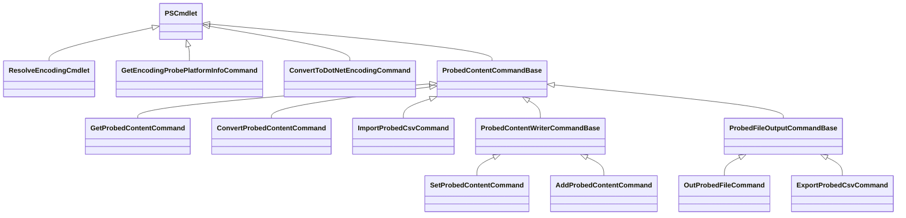
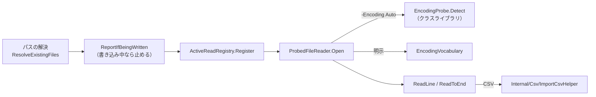
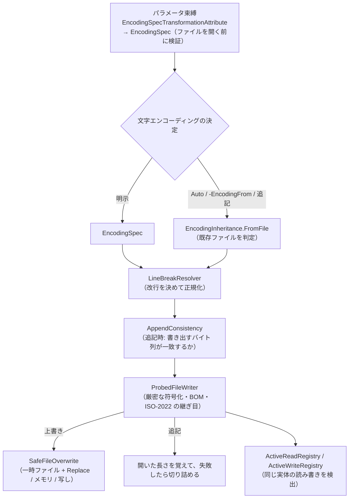
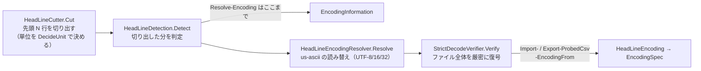
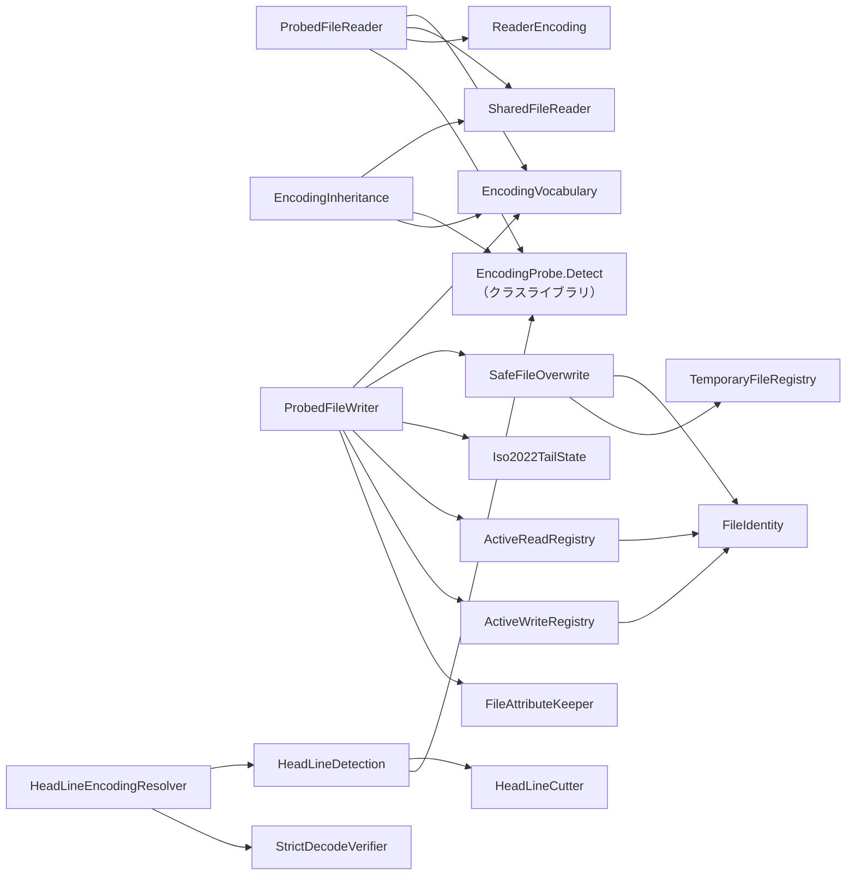

# SnowStack.EncodingProbe.PowerShell ソースコード解説書（PowerShell モジュール）

この文書は、PowerShell モジュール `SnowStack.EncodingProbe.PowerShell`（バイナリモジュール）のソースコードの**地図**である。
どのコマンドがどの部品を使い、部品どうしがどうつながっているかを短時間でつかむことを目的にする。
個々の挙動の細部・決定の経緯は書かない。ソースコードのコメントと、末尾の「関連文書」を見ること。

判定エンジン（クラスライブラリ）の解説書は `docs/EncodingProbe-ソースコード解説書-クラスライブラリ.md` にある。

対象: 1.3.0 時点（ブランチ `feature/1.3.0-csv`）。

---

## 1. ひとことで言うと

クラスライブラリの判定を使って、**文字エンコーディングを保ったまま**テキストファイルを読み書きするコマンド群。
PowerShell 5.1（net48）と 7.x（net10.0）で**同じ名前・同じ指定が同じ結果になる**ことを目標にしている。

設計の柱は 4 つ:

1. **統一語彙** — `-Encoding` の名前を 5.1 / 7.x 共通の体系で解決する（`EncodingVocabulary`）
2. **判定はファイル全体** — 例外は 1.3.0 の `-DetectionLineCount`（先頭 N 行で判定し、CSV 系は全体を厳密検証）
3. **書き込みを壊さない** — 表現できない文字・失敗・同じファイルの読み書きを検出し、元に戻す（`SafeFileOverwrite` ほか）
4. **メッセージは 5 言語** — 英語・日本語・韓国語・繁体字・簡体字（`MessageCatalog`）

---

## 2. フォルダー構成

```
SnowStack.EncodingProbe.PowerShell/
├─ Cmdlets/                     コマンド（10 個）と 3 つの基底クラス、オプション検証
├─ Internal/                    部品（約 50 ファイル。下の 5 章で分類）
│   └─ Csv/                     PowerShell 7 の CsvCommands.cs からの移植（MIT。改変しない）
├─ en-US/ ja-JP/ ko-KR/ zh-TW/ zh-CN/ zh-HK/ zh-MO/
│                               MAML ヘルプ（zh-HK / zh-MO は zh-TW の複製）
├─ EncodingProbeModuleInitializer.cs   Import-Module 時に CodePagesEncodingProvider を登録
├─ ValidationMessages.cs        メッセージの入口（中身は MessageCatalog から引く）
├─ LicenseAndHelp.cs            Resolve-Encoding -License のモジュール側の文字列
├─ BomOption.cs / LineBreakOption.cs   公開の列挙型（-Bom / -LineBreak）
└─ EncodingProbePlatformInformation.cs / PowerShellHostInformation.cs
                                Get-EncodingProbePlatformInfo の出力型

publish/SnowStack.EncodingProbe.PowerShell/
├─ .psd1 / .psm1                マニフェストとローダー（$PSEdition で core\ / desktop\ の DLL を読み分ける）
└─ core/ desktop/               ビルド出力を手で配置する（DLL とヘルプは git 管理外）
```

---

## 3. コマンド一覧と継承関係

| コマンド | クラス | 基底クラス | 版 | 一言 |
|---|---|---|---|---|
| `Resolve-Encoding` | `ResolveEncodingCmdlet` | `PSCmdlet` | 1.0 | ファイルの文字エンコーディングを判定して `EncodingInformation` を返す |
| `Get-EncodingProbePlatformInfo` | `GetEncodingProbePlatformInfoCommand` | `PSCmdlet` | 1.0 | 実行環境情報 |
| `ConvertTo-DotNetEncoding` | `ConvertToDotNetEncodingCommand` | `PSCmdlet` | 1.1 | 統一語彙の名前 → `System.Text.Encoding` |
| `Get-ProbedContent` | `GetProbedContentCommand` | `ProbedContentCommandBase` | 1.1 | 判定して読む（`Get-Content` 相当） |
| `Set-ProbedContent` | `SetProbedContentCommand` | `ProbedContentWriterCommandBase` | 1.1 | 上書き（`Set-Content` 相当） |
| `Add-ProbedContent` | `AddProbedContentCommand` | `ProbedContentWriterCommandBase` | 1.1 | 追記。既存の文字エンコーディングとの整合性を検査 |
| `Out-ProbedFile` | `OutProbedFileCommand` | `ProbedFileOutputCommandBase` | 1.2 | 整形して書く（`Out-File` 相当） |
| `Convert-ProbedContent` | `ConvertProbedContentCommand` | `ProbedContentCommandBase` | 1.2 | 文字エンコーディング・BOM・改行の変換。文字を失うなら変換しない |
| `Import-ProbedCsv` | `ImportProbedCsvCommand` | `ProbedContentCommandBase` | 1.3 | 判定して CSV を読む |
| `Export-ProbedCsv` | `ExportProbedCsvCommand` | `ProbedFileOutputCommandBase` | 1.3 | CSV を書く・追記する |



### 3.1 基底クラスの役割

| 基底クラス | 持っているもの |
|---|---|
| `ProbedContentCommandBase` | `-Culture` / `-Strategy`（`BeginProcessing` で検証し `DetectorOptions` にする）、パスの解決（`ResolveExistingFiles` / `ResolveWritablePaths`）、`-EncodingFrom` の解決、逆向きの往復の検出（`ReportIfBeingWritten`）、エラーの組み立て。**派生側は必ず `base.BeginProcessing()` を先に呼ぶ** |
| `ProbedContentWriterCommandBase` | `Set-` / `Add-ProbedContent` の共通部分。`-Path` / `-LiteralPath` / `-Value` / `-Encoding` / `-LineBreak` など。書き込み先の表（同じ実体への重複書き込みの管理）。派生側の差は `CreateWriter`（開き方）と `RejectChunk`（内容の検査）だけ |
| `ProbedFileOutputCommandBase` | `Out-ProbedFile` / `Export-ProbedCsv` の「殻」。出力パスの解決、`-NoClobber` と読み取り専用の検査、最初の行を書く直前に開く処理、追記の整合性検査、空の入力、後始末。文字エンコーディングの決め方は派生側 |

`Cmdlets/ResolveEncodingOptions` は `-Culture` / `-Strategy` の検証と、判定方式の名前の表（`TryParseStrategy`）を**全コマンドで共有**する静的クラス。

---

## 4. 処理の流れ（代表的な 3 種）

### 4.1 読み込み（`Get-ProbedContent` / `Import-ProbedCsv`）



`Import-ProbedCsv -DetectionLineCount` のときは、`ProbedFileReader` の前に `HeadLineEncodingResolver.Resolve` で
先頭 N 行の判定と全体の厳密検証を行う（4.4 節）。

### 4.2 書き込み（`Set-` / `Add-ProbedContent`、`Out-ProbedFile`、`Export-ProbedCsv`）



**規則:** エラーで止まったら、そのファイルには、その呼び出しで書いた分を残さない（`Rollback`）。

### 4.3 変換（`Convert-ProbedContent`）

```
SharedFileReader.ReadAll（全体を読む）
 → 変換元の決定（判定 or -SourceEncoding）
 → 厳密に復号（不正バイトの位置は FindInvalidBytes で自前に求める）
 → 改行の変換（LineBreakResolver）
 → 厳密に符号化 + BOM
 → その場での変換で、元のバイト列と同じなら書き直さない
 → SafeFileOverwrite で置き換え（-Destination なら別フォルダーへ）
```

`Convert-ProbedContent` は書き込み系の基底クラスを使わず、`SafeFileOverwrite` を直接使う（1 ファイル = 1 回の置き換え）。

### 4.4 `-DetectionLineCount`（1.3.0）



3 コマンドの判定結果（読み替え前）が一致するのは、この部品を共用しているため。

---

## 5. Internal の部品（役割別）

### 5.1 文字エンコーディングの語彙と指定

| クラス | 役割 |
|---|---|
| `EncodingVocabulary` | **統一語彙の解決の中心**。名前・コードページ・`Encoding` オブジェクト → `EncodingSpec`。`BuildStrictEncoding`（例外フォールバック）、`GetUnifiedName`、継承した us-ascii を UTF-8 とみなす処理 |
| `EncodingSpec` | 文字エンコーディング・BOM 方針・改行の 3 項を持つ内部表現（internal のまま公開しない） |
| `EncodingSpecTransformationAttribute` | `-Encoding` をパラメータ束縛の段階で `EncodingSpec` に変換・検証する |
| `ConvertEncodingArgument`（`ConvertEncodingTransformationAttribute` を含む） | `Convert-ProbedContent -Encoding` 用。解決結果と元の値の両方を持つ |
| `EncodingUsage` | 読み取り用途か書き込み用途か（許される指定が違う） |
| `EncodingInheritance` | 既存ファイルから文字エンコーディング・BOM・改行を継承する（判定を呼ぶ） |
| `CodePagesProviderRegistration` | `CodePagesEncodingProvider` の登録を保証する |
| `ReaderEncoding` | `StreamReader` に渡す、preamble を持たない `Encoding` の包み（BOM の二重読み飛ばし対策、net48 の flush 対策） |

### 5.2 読み込み

| クラス | 役割 |
|---|---|
| `ProbedFileReader` | **読み込みの唯一の入口**。判定（または指定）して BOM を除き、`StreamReader` で読む |
| `SharedFileReader` | 判定・変換のためにファイル全体を `FileShare.ReadWrite` で読む（`File.ReadAllBytes` は使わない） |

### 5.3 書き込み

| クラス | 役割 |
|---|---|
| `ProbedFileWriter` | **書き込みの唯一の入口**。`Create` / `Append` / `Open`、厳密な符号化、BOM の自前の書き出し、`Complete` / `Rollback` |
| `SafeFileOverwrite` | 上書きの方式を選んで実行する（`Replace` = 一時ファイルと `File.Replace`、`MemoryThenDirect` = 1 MiB 以内、`CopyThenDirect` = ハードリンクなど）。`Convert-ProbedContent` も共用 |
| `LineBreakResolver` | 書き込みに使う改行の決定と、文字列の改行の正規化・分類 |
| `AppendConsistency` | 追記しても既存ファイルとバイト列が一致するか（名前の比較ではない） |
| `Iso2022TailState` | ISO-2022 の追記先が ASCII 以外の状態で終わっていれば、戻すシーケンスを求める |
| `ReadOnlyAttributeScope` | `-Force` で外した読み取り専用属性を元に戻す |
| `FileAttributeKeeper` | 成功時の Archive 属性、元に戻したときの属性 |
| `TemporaryFileRegistry` | 書き込み途中の一時ファイル（ワイルドカードの解決から除く） |
| `RollbackNotice` | 元に戻せなかったことをメッセージに添える |

### 5.4 ファイルとパス

| クラス | 役割 |
|---|---|
| `FileIdentity` | **ファイルの実体**（Windows はボリュームのシリアル番号 + ファイル ID、それ以外はリンクを解決したパス）。同じファイルかどうかはこれで比べる |
| `FileSystemPath` | プロバイダーのパス → 絶対パス（`a.txt::$DATA` の扱い、代替データストリームの拒否） |
| `PathComparison` | パスの文字列の比較（**同じファイルの判定には使わない**） |
| `ActiveReadRegistry` | 読み取り中のファイル。書き込み側が開くときに照合する（`Get a.txt \| Set a.txt` の検出） |
| `ActiveWriteRegistry` | 書き込み中のファイル。読み込み側が開くときに照合する（逆向きの往復） |
| `FileErrors` | 読み書きの失敗を 5 言語のメッセージの例外に包み直す |

### 5.5 先頭 N 行の判定（`-DetectionLineCount`）

| クラス | 役割 |
|---|---|
| `HeadLineCutter`（`HeadLineCut`） | 先頭 N 行の切り出し。単位（1 バイト / UTF-16 / UTF-32）の決定は `DecideUnit` |
| `LineBreakUnit` | 切り出しの単位 |
| `HeadLineDetection`（`HeadLineDetectionResult`） | 切り出した分の判定 |
| `HeadLineEncodingResolver`（`HeadLineEncoding`） | 読み替えと全体の検証まで |
| `StrictDecodeVerifier`（`StrictDecodeFailure`） | ファイル全体の厳密な復号と、最初の不正バイトの位置 |
| `DetectionVerificationException` | 全体の検証の失敗 |

### 5.6 CSV

| クラス | 役割 |
|---|---|
| `Csv/ImportCsvHelper` / `Csv/ExportCsvHelper` / `Csv/ImportExportCSVHelper` / `Csv/CsvQuoteKind` | PowerShell 7 からの**移植**。解析と文字列化。ここには移植したコードだけを置き、改良しない |
| `CsvPropertyViews` | 移植元の内部 API（プロパティの見え方）の置き換え |
| `CsvNameComparer` / `CsvNameCaseTable` | 列名の大文字小文字を無視した比較。net48 でも .NET 10 と同じ結果にする（表は `tools/New-CsvNameCaseTable.ps1` で生成） |
| `CsvDuplicateColumnName` | 列名の重複のメッセージの差し替え |

### 5.7 メッセージと例外

| クラス | 役割 |
|---|---|
| `MessageCatalog` | 5 言語のメッセージの表。言語は `CurrentUICulture` を `EncodingDetector.ResolveEastAsianLegacyRegion` に通して決める（香港は台湾と同じ辞書） |
| `MessageKey` | メッセージの識別子 |
| `ValidationMessages`（ルート） | コマンドが呼ぶメッセージの関数群。中身は `MessageCatalog.Format` |
| `ByteSequenceText` | 不正なバイト列をメッセージ用の文字列にする |
| `EncodingDetectionException` | 文字エンコーディングを決められなかった。`GuardMemory` で全体判定のメモリ不足も包む |
| `UnrepresentableCharacterException` / `SameFileRoundTripException` | 表現できない文字 / 同じ実体の読み書き |

---

## 6. 依存関係の早見表

コマンドから見た主な部品（`ValidationMessages` と `EncodingSpec` はほぼ全部が使うので省略）。

| コマンド / 基底 | 主な部品 |
|---|---|
| `Resolve-Encoding` | `ResolveEncodingOptions`、`FileSystemPath`、`SharedFileReader`、`HeadLineDetection`、クラスライブラリ `EncodingProbe.Detect` |
| `Get-ProbedContent` | `ProbedFileReader`、`ActiveReadRegistry` |
| `Import-ProbedCsv` | `ProbedFileReader`、`HeadLineEncodingResolver`、`StrictDecodeVerifier`、`Csv/ImportCsvHelper`、`CsvDuplicateColumnName` |
| `Set-` / `Add-ProbedContent`（`ProbedContentWriterCommandBase`） | `ProbedFileWriter`、`EncodingInheritance`、`LineBreakResolver`、`AppendConsistency`（Add のみ）、`ReadOnlyAttributeScope`、`FileIdentity` |
| `Out-ProbedFile` / `Export-ProbedCsv`（`ProbedFileOutputCommandBase`） | `ProbedFileWriter`、`EncodingInheritance`、`AppendConsistency`、`ReadOnlyAttributeScope`。Export はさらに `HeadLineEncodingResolver`・`ProbedFileReader`（ヘッダーの読み取り）・`Csv/ExportCsvHelper` |
| `Convert-ProbedContent` | `SharedFileReader`、`EncodingVocabulary.BuildStrictEncoding`、`LineBreakResolver`、`SafeFileOverwrite`、`FileIdentity`、`ConvertEncodingArgument` |
| `ConvertTo-DotNetEncoding` | `EncodingSpecTransformationAttribute` → `EncodingVocabulary` のみ（判定を呼ばない） |
| `Get-EncodingProbePlatformInfo` | クラスライブラリの `Internal/PlatformInfoResolver` |

部品どうしの主なつながり:



---

## 7. PowerShell 5.1 / 7.x の違いを吸収している所

| 違い | 吸収している所 |
|---|---|
| .NET Core では CP932 などが既定で取れない | `EncodingProbeModuleInitializer`、`CodePagesProviderRegistration` |
| `-Encoding` の名前の体系 | `EncodingVocabulary`（統一語彙） |
| 例外の `Index` の基準が違う | `ConvertProbedContentCommand.FindInvalidBytes`、`StrictDecodeVerifier` |
| `StreamReader` の BOM・末尾の flush | `ReaderEncoding` |
| 大文字小文字を無視した比較の結果 | `CsvNameComparer` / `CsvNameCaseTable` |
| `Path.GetFullPath` の代替データストリームの扱い | `FileSystemPath` |
| ホストの `Import-Csv` / `Export-Csv` の違い | `Internal/Csv/` の移植（ホストのコマンドを呼ばない） |
| 例外のメッセージの文言 | `MessageCatalog`（実行環境の例外を利用者に見せない） |

---

## 8. テストとの対応

| 場所 | 内容 |
|---|---|
| `tests/EncodingProbe.PowerShell.Tests/CmdletTests/` | コマンドごとのテスト（`<コマンド名>Tests.cs`）と横断的な検査（同じファイル、リンクと権限、ヘルプの骨格の一致 `MamlHelpTests` など） |
| `.../EncodingTests/` | 語彙・メッセージ・先頭 N 行の切り出し・厳密検証など部品のテスト |
| `.../FileSystemTests/` | `FileIdentity`・`SafeFileOverwrite` |
| `.../CsvTests/` | 移植した CSV コードのテスト |
| `tests/PSCompat/` | 同じシナリオを PS 5.1 と 7.x で実行して結果を突き合わせる（読み書き系を変えたら必ず実行） |

テストは net10.0 のみ（`Microsoft.PowerShell.SDK` を参照）。5.1 側の一致は PSCompat で確かめる。

---

## 9. 変更するときの入口

| やりたいこと | 見る所 |
|---|---|
| `-Encoding` に新しい名前を足す | `EncodingVocabulary`（解決順序に意味がある） |
| 読み込みの挙動 | `ProbedFileReader` |
| 書き込み・上書きの挙動 | `ProbedFileWriter` → `SafeFileOverwrite` |
| 同じファイルの検出 | `FileIdentity`、`ActiveReadRegistry` / `ActiveWriteRegistry` |
| メッセージを足す | `MessageKey` → `MessageCatalog`（5 言語すべて）→ `ValidationMessages` |
| パラメータを足す | コマンドのクラス + **MAML ヘルプ 5 言語**（zh-HK / zh-MO へ複製）+ `.psd1`。手順は `.claude/skills/release-checklist/SKILL.md` |

---

## 10. 関連文書

- `SnowStack.EncodingProbe.PowerShell/CLAUDE.md` … モジュールの決定事項の要約（**変更前に必ず読む**）
- ルートの `CLAUDE.md` … 全体の決定事項、ビルド・テストの手順
- `docs/EncodingProbe-1.1.0-仕様書.md` … 読み書きコマンドと統一語彙
- `docs/EncodingProbe-1.2.0-仕様書.md` / `-実装記録.md` … `Out-ProbedFile` / `Convert-ProbedContent`
- `docs/EncodingProbe-1.3.0-仕様書.md` / `-実装記録.md` … CSV、`-DetectionLineCount`、書き込みの安全性
- `docs/EncodingProbe-作業状況.md` … 各版の作業記録
