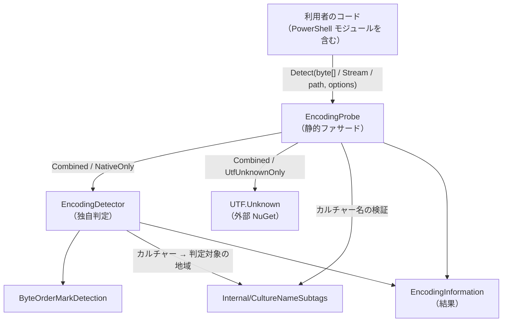
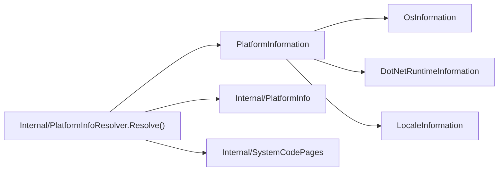
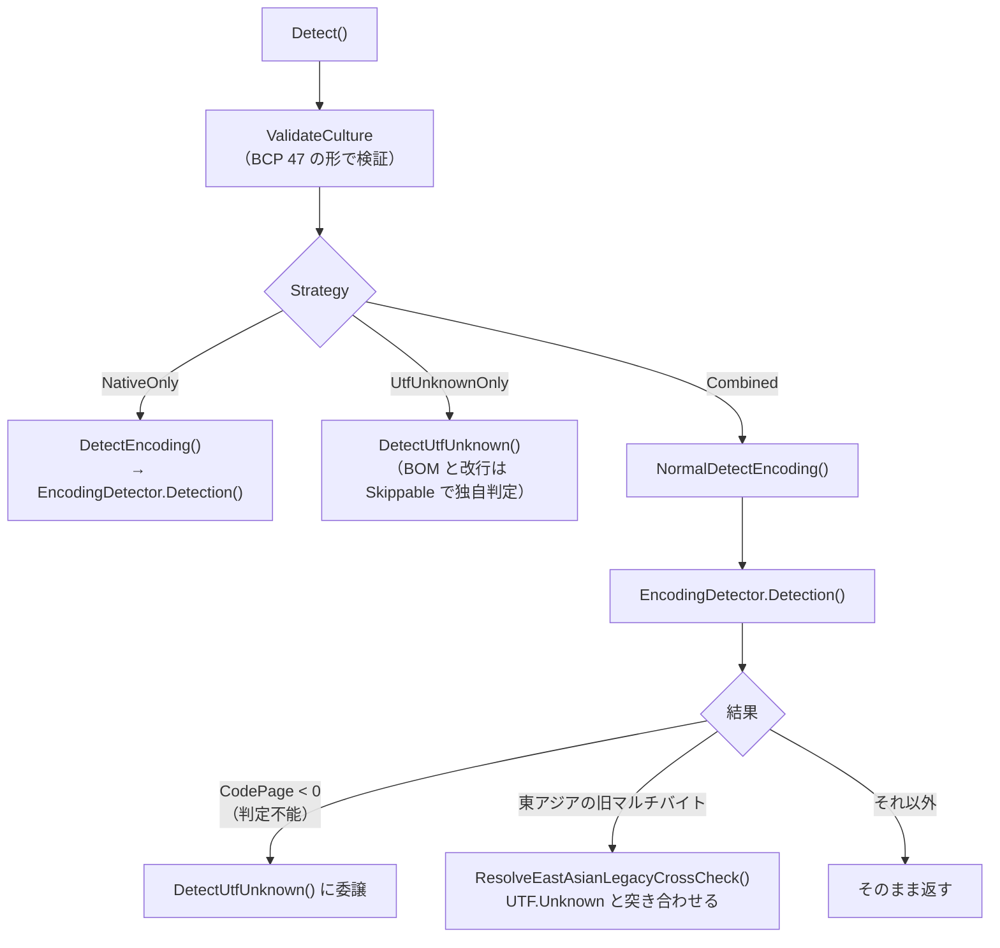
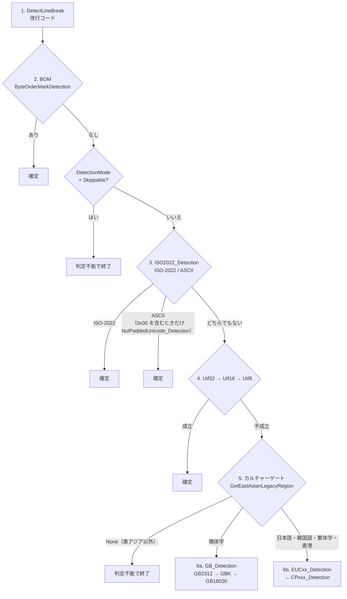
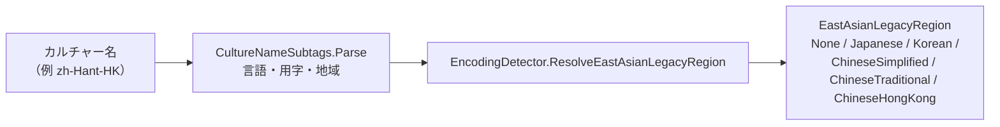

# SnowStack.EncodingProbe ソースコード解説書（クラスライブラリ）

この文書は、クラスライブラリ `SnowStack.EncodingProbe`（NuGet パッケージ）のソースコードの**地図**である。
どのファイルに何があり、どれがどれを呼ぶかを短時間でつかむことを目的にする。
個々の判定規則の細部・決定の経緯は書かない。ソースコードのコメントと、末尾の「関連文書」を見ること。

PowerShell モジュールの解説書は `docs/EncodingProbe-ソースコード解説書-PowerShellモジュール.md` にある。

対象: 1.3.0 時点（ブランチ `feature/1.3.0-csv`）。

---

## 1. ひとことで言うと

バイト列（またはストリーム・ファイル）を受け取り、**文字エンコーディング・BOM の有無・改行コード**を推測して
`EncodingInformation` で返すライブラリ。

- 東アジア（日本語・韓国語・中国語）の旧マルチバイトと Unicode 系は**独自判定**（`EncodingDetector`）が担当する
- 欧米のシングルバイト（windows-1252 など）は外部ライブラリ **UTF.Unknown** が担当する
- 2 つの結果を `EncodingProbe`（静的クラス）が組み合わせる

ターゲットは `net10.0`（PowerShell 7.x 向け）と `net48`（Windows PowerShell 5.1 向け）。

---

## 2. ファイル一覧

ファイルは少ない。実質的なロジックは 2 ファイル（`EncodingProbe.cs` と `EncodingDetector.cs`）に集中している。

| ファイル | 行数 | 公開 | 役割 |
|---|---:|:---:|---|
| `EncodingProbe.cs` | 約 690 | ○ | **入口（静的ファサード）**。戦略の振り分け、UTF.Unknown との突き合わせ、ライセンス文字列 |
| `EncodingDetector.cs` | 約 2550 | ○ | **独自判定エンジン**。改行・BOM・ISO-2022・ASCII・UTF-32/16/8・東アジアの旧マルチバイト。`LineBreakType` 列挙型もここ |
| `ByteOrderMarkDetection.cs` | 約 160 | – | BOM（UTF-8 / UTF-16 LE・BE / UTF-32 LE・BE）の照合 |
| `EncodingInformation.cs` | 約 40 | ○ | 判定結果の型（record） |
| `EncodingDetectorOptions.cs` | 約 35 | ○ | オプション（`Strategy` / `Culture`）と `DetectionStrategy` / `DetectionMode` 列挙型 |
| `EncodingDetectorException.cs` | 約 25 | ○ | 例外型 |
| `PlatformInformation.cs` ほか 3 つ | 各 20〜30 | ○ | 実行環境情報の record（`OsInformation` / `DotNetRuntimeInformation` / `LocaleInformation`） |
| `Internal/CultureNameSubtags.cs` | 約 310 | – | カルチャー名（BCP 47）を言語・用字・地域に分解する。形の検証も行う |
| `Internal/PlatformInfoResolver.cs` | 約 80 | – | `PlatformInformation` を組み立てる（PowerShell モジュールだけが使う） |
| `Internal/PlatformInfo.cs` | 約 15 | – | Windows / macOS / Linux の判定（net48 は Windows 固定） |
| `Internal/SystemCodePages.cs` | 約 65 | – | ANSI / OEM コードページの取得（Windows は `GetACP` / `GetOEMCP`） |

「公開」が – のものは `internal`。`InternalsVisibleTo` で **PowerShell モジュールとテストプロジェクトからだけ**見える
（公開 API を増やさずに部品を共有するため）。

---

## 3. 全体の構造



実行環境情報の系統（判定とは独立）:



---

## 4. 公開 API

利用者が触るのは実質この 3 つだけ。

```csharp
var info = EncodingProbe.Detect(bytes);                       // byte[] / Stream / ファイルパス
var info = EncodingProbe.Detect(path, new EncodingDetectorOptions
{
    Strategy = DetectionStrategy.Combined,                    // 既定
    Culture  = "ja-JP",                                       // 省略時は CurrentCulture
});
```

| 型 | 中身 |
|---|---|
| `EncodingProbe.Detect(...)` | 3 つのオーバーロード（`byte[]` / `Stream` / `string filePath`）。カルチャー名を検証してから戦略で振り分ける |
| `EncodingDetectorOptions` | `Strategy`（`Combined` / `UtfUnknownOnly` / `NativeOnly`）と `Culture` |
| `EncodingInformation` | `CodePage`（判定不能は `-1`）、`EncodingWebName`、`PSEncodingName`、`UsePSName`、`Bom`、`LineBreak`、`Culture` |
| `EncodingDetector` | 独自判定を直接使う場合のクラス。`new EncodingDetector(bytes).Detection(culture)`、`DetectLineBreak()` |
| `LineBreakType` | `None` / `CrLf` / `Lf` / `Cr` / 混在 4 種 |
| `EncodingProbe.License` | ライセンス表記の文字列（UTF.Unknown の MPL 1.1 表記を含む） |

**`PSEncodingName` / `UsePSName` は TFM によって意味が違う**（net10.0 は PS 7 のフレンドリ名、net48 は PS 5.1 の固定列挙値）。
`EncodingDetector.cs` の `#if NETFRAMEWORK` で実装が分かれている。

---

## 5. 判定の流れ

### 5.1 `EncodingProbe`（戦略の振り分けと突き合わせ）



突き合わせ（`ResolveEastAsianLegacyCrossCheck`）で起きることは 2 つ:

1. **シングルバイトへの上書き** — UTF.Unknown が十分な信頼度でシングルバイトを返したら、そちらを採る
   （`ShouldPreferUtfUnknown`）。独自判定はバイト構造しか見ないため、欧米のテキストを Shift_JIS などと誤判定しうる
2. **繁簡の系統の差し替え** — 独自判定が Big5 系 / GB 系を返し、UTF.Unknown が反対の系統を返したら、
   `EncodingDetector.RedetectChineseLegacy` で反対の系統の判定をやり直す

信頼度の下限は役割ごとに 3 つの定数がある（`EncodingProbe.cs` の先頭付近）:

| 定数 | 値 | 使う所 |
|---|---:|---|
| `UtfUnknownAdoptionThreshold` | 0.5 | UTF.Unknown の結果を答えとして採用する（`ApplyUtfUnknownResult`） |
| `SingleByteOverrideThreshold` | 0.55 | 旧マルチバイトをシングルバイトで上書きする |
| `ChineseFamilyOverrideThreshold` | 0.8 | 繁簡の系統を差し替える |

値は実測に基づく。変えるときはルートの `CLAUDE.md` と測定文書を読むこと。

`EncodingProbe.cs` のメソッドの並び:

| メソッド | 役割 |
|---|---|
| `Detect` ×3 | 公開の入口 |
| `DetectEncoding` ×3（internal） | `NativeOnly` の本体。`DetectionMode` を指定できる |
| `NormalDetectEncoding` ×3 | `Combined` の本体 |
| `DetectUtfUnknown` ×5 | `UtfUnknownOnly` の本体。まず `DetectEncoding(..., Skippable)` で BOM の有無と改行だけを独自判定で調べ、そこへ UTF.Unknown の結果を重ねる |
| `ApplyUtfUnknownResult` | UTF.Unknown の結果を反映する（下限 0.5） |
| `IsEastAsianLegacyMultiByteCodePage` / `IsSingleByteCodePage` | コードページの分類表 |
| `ShouldPreferUtfUnknown` / `GetChineseLegacyFamily` / `ShouldSwitchChineseFamily` / `ResolveEastAsianLegacyCrossCheck` | 突き合わせ |

### 5.2 `EncodingDetector.Detection(culture)`（独自判定）

**判定順序に意味がある。入れ替えると誤判定する。**



- 1〜4 は**カルチャーに関わらず必ず実行**する（UTF.Unknown は BOM 無しの UTF-16 / UTF-32 を判定できないため）
- UTF-16 / UTF-32 に決まったら、改行をその単位で数え直す（`RecountLineBreakByUnit`）
- 6b で EUC と CPxxx の両方に当てはまる曖昧な入力は、カルチャーと改行で決める
  （EUC-JP / Shift_JIS は CRLF なら Shift_JIS など）。決めた候補で厳密に復号できなければもう一方を採る（`ExcludeUndecodableCandidate`）

`EncodingDetector.cs` の中の配置（上から順）:

| 行の目安 | 内容 |
|---|---|
| 15〜 | `LineBreakType` 列挙型 |
| 38〜170 | コードページの定数、コンストラクタ（`byte[]` / `Stream` / パス） |
| 177〜370 | 改行コードの判定（`DetectLineBreak`、単位ごとの数え直し） |
| 378〜520 | 名前の表: `EncodingName`（WebName）、`PSEncodingName` / `SetUsePSName`（**TFM ごとに 2 つ**） |
| 547〜820 | **`Detection`（判定の本体。上の図の順）** |
| 823〜880 | 曖昧な候補の厳密復号による除外（`ExcludeUndecodableCandidate` / `CanDecodeStrictly`） |
| 884〜1020 | **カルチャーゲート**: `EastAsianLegacyRegion` 列挙型と `ResolveEastAsianLegacyRegion`（カルチャー名 → 地域の対応表。ここに集約） |
| 1026〜1290 | ISO-2022 / ASCII、`0x00` 入り ASCII の UTF-16/32 判定 |
| 1289〜1750 | UTF-16 / UTF-32 / UTF-8 の判定（UTF-8 は RFC 3629 の整形式どおりに厳密） |
| 1759〜1960 | EUC 系（EUC-JP / EUC-KR / EUC-TW）とカルチャー別の選択 |
| 1962〜2140 | Shift_JIS、カルチャー別の CPxxx の選択、`RedetectChineseLegacy`（系統差し替え用） |
| 2188〜2548 | CP949 / CP936 / GB の 3 段階 / CP950 のバイト構造の検査 |

各 `xxx_Detection` は「**規格外なら true**」（`outOfSpecification`）を返す形にそろっている。読むときに真偽を取り違えないこと。

### 5.3 カルチャーの扱い



- `CultureInfo` の親チェーンは使わない（NLS と ICU で結果が違うため）。名前をサブタグに分解して引く
- 受け付けるかどうかも名前の形（`CultureNameSubtags.IsWellFormed`）で決める
- `CultureInfo.CurrentCulture` へのフォールバックは `Detection` の 1 か所だけ
- PowerShell モジュールのメッセージの言語選択も同じ `ResolveEastAsianLegacyRegion` を使う

---

## 6. 依存関係

| 依存先 | 用途 | 注意 |
|---|---|---|
| UTF.Unknown | シングルバイト系の判定 | **net10.0 は 2.7.0、net48 は 2.6.0（意図した非対称）**。ライセンスは MPL 1.1 |
| `System.Text.Encoding.CodePages`（net10.0） | 厳密復号の検査（`CanDecodeStrictly`）で `CodePagesEncodingProvider.Instance` から直接取り出す | グローバルには登録しない（登録は PowerShell モジュールの役目） |
| PolySharp（net48） | record などの新しい言語機能を net48 で使う | ビルド時のみ |

---

## 7. テストとの対応

テストは `tests/EncodingProbe.Tests`（xUnit、net10.0 / net48 の両方で動かす）。

| フォルダー | 内容 |
|---|---|
| `DetectorTests/` | 判定のテスト。主なもの: `WorldLanguageTests`（各言語）、`CrossCheckConfidenceTests`（下限の境界）、`KnownLimitTests`（既知の限界を固定。正しい挙動ではない）、`NulInputDetectionTests`、`PS51EncodingNameTests`（TFM ごとの名前）、`CultureNameValidationTests`、`Utf8StrictnessTests` |
| `PrivateUseAreaTests/` | 私用領域の往復検査 |
| `TestData/<言語>/` | 言語別・エンコーディング別のサンプル。**エディタで開いて保存しないこと**（エンコーディングが変わる）。一部は `tools/New-EncodingTestData.ps1` で生成 |

---

## 8. 変更するときの入口

| やりたいこと | 見る所 |
|---|---|
| 判定結果がおかしい | `EncodingDetector.Detection` の順序 → 該当の `xxx_Detection`。`Combined` なら `EncodingProbe.NormalDetectEncoding` の突き合わせも |
| カルチャーの対応を変える | `EncodingDetector.ResolveEastAsianLegacyRegion` と `Internal/CultureNameSubtags`（表を増やさないこと） |
| UTF.Unknown との閾値 | `EncodingProbe.cs` の 3 つの定数。`tools/Invoke-CrossCheckMeasurement.ps1` で再測定 |
| 結果の名前（WebName / PS 名） | `EncodingDetector.EncodingName` / `PSEncodingName`（TFM ごと） |

---

## 9. 関連文書

- ルートの `CLAUDE.md` … 判定順序・閾値・カルチャーの決定事項の要約（変更前に必ず読む）
- `README.md` … 利用者向けの説明、独自判定と UTF.Unknown の分業の理由
- `docs/EncodingProbe-1.2.0-調査-クロスチェック信頼度の測定.md` … 閾値の実測
- `docs/EncodingProbe-1.3.0-仕様書-追補-NUL入りの入力の判定.md` … `0x00` を含む入力
- `docs/私用領域の扱い_方針草案.md` … 外字・HKSCS に介入しない方針
- `docs/EncodingProbe-作業状況.md` … 各版の作業記録
